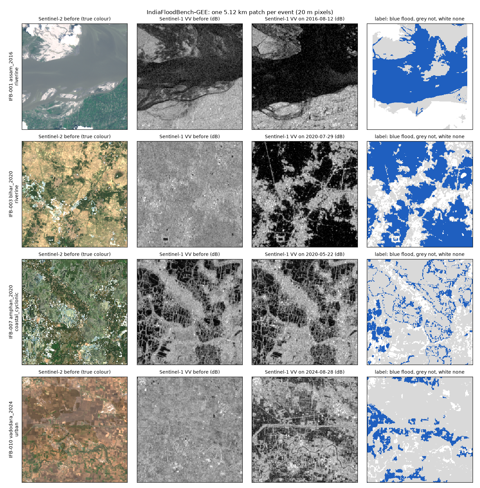

# IndiaFloodBench-GEE

**A dataset of ten real Indian floods, seen by satellites before and during the flood, with a
"flooded / not flooded" answer for every pixel. Built with Google Earth Engine.**



## In one minute

- **What problem it is for.** Teaching a computer to look at a satellite image and say which
  places are flooded. Public datasets for this contain almost no Indian floods, and Indian floods
  are hard: monsoon clouds, huge farm floodplains, rice paddies that are flooded on purpose,
  cyclones on mangrove coasts.
- **What is in it.** 10 floods from 2016 to 2024 in 8 states (Assam, Kerala, Bihar, Punjab,
  Andhra Pradesh, West Bengal, Odisha, Gujarat), cut into 196 squares of 5.12 km. For each square:
  radar images (Sentinel-1) and photographs (Sentinel-2) from before and during the flood,
  rainfall, height of the ground, land cover, and the flood map. Also a table of 49,619 sampled
  pixels with all of those values.
- **Where the answers come from.** One flood (Assam 2016) was mapped by hand by analysts. The other
  nine use an automatic flood map from the European Copernicus programme (GFM). Automatic maps are
  usually right when they say "flood" but miss about two thirds of flooded pixels. Details in
  [`dataset_card.md`](dataset_card.md).
- **What it is not.** No trained model, not an early-warning system, and not a large benchmark. It
  is a small, carefully checked test bed for Indian floods.

## Start here

| If you want to... | Read |
|---|---|
| understand the ideas (radar, labels, permanent water) from zero | [`docs/how_it_was_built.md`](docs/how_it_was_built.md), sections 1-3 |
| look up a word | [`docs/glossary.md`](docs/glossary.md) |
| load the data and use it correctly | [`docs/using_the_data.md`](docs/using_the_data.md) |
| run working code in 30 seconds | [`examples/quickstart.py`](examples/quickstart.py) |
| know exactly what every column and band means | [`schema.md`](schema.md) |
| know how good the labels are, and every limitation | [`dataset_card.md`](dataset_card.md) |
| see the measured numbers | [`FINAL_AUDIT.md`](FINAL_AUDIT.md), [`data_quality_report.md`](data_quality_report.md) |
| rebuild everything yourself | [Rebuild](#rebuild) below |

## Quick start

```bash
git clone https://github.com/parth-sharma-10/IndiaFloodBench-GEE.git
cd IndiaFloodBench-GEE
pip install pandas pyarrow numpy rasterio
python examples/quickstart.py
```

The table (`data/tabular/indiafloodbench.parquet`, also `.csv`) is in the repository. The image
squares (875 MB of GeoTIFFs) are a release download:

```bash
gh release download v2.0 -p 'indiafloodbench_gee_raster_v2.0.zip' && unzip -q indiafloodbench_gee_raster_v2.0.zip
```

Or download `indiafloodbench_gee_raster_v2.0.zip` from the Releases page and unzip it here.

## The ten floods

| id | flood | type | flood-day image |
|---|---|---|---|
| IFB-001 | Assam 2016 (hand-labelled) | river | 2016-08-12 |
| IFB-002 | Kerala 2018 | river and rain | 2018-08-21 |
| IFB-003 | Bihar 2020 | river | 2020-07-29 |
| IFB-004 | Assam 2022 | river | 2022-06-16 |
| IFB-005 | Punjab 2023 | river | 2023-07-12 |
| IFB-006 | Vijayawada 2024 | city and river | 2024-09-01 |
| IFB-007 | Cyclone Amphan 2020 | coastal | 2020-05-22 |
| IFB-008 | Cyclone Yaas 2021 | coastal | 2021-05-29 |
| IFB-009 | Assam 2024 | river | 2024-07-06 |
| IFB-010 | Vadodara 2024 | city | 2024-08-28 |

## Three things to know before using it

1. **Never split pixels of the same square between training and testing.** Neighbouring pixels are
   near-copies, so the score would be fake. Hold out whole floods; ready-made splits are in
   `data/metadata/splits.json`.
2. **Nine labels were made from the same radar image you are given.** A model can score well by
   copying that method. Test on Assam 2016 (hand labels) to get an honest number.
3. **The table is balanced on purpose (about 40% flood).** Real floods covered 2.6% to 23% of each
   area. Weight rows by `1 / inclusion_prob` to get real proportions.

More in [`docs/using_the_data.md`](docs/using_the_data.md).

## Where the data comes from

Every image layer is computed in **Google Earth Engine** and fetched onto the exact grid of each
square: Sentinel-1 radar (`COPERNICUS/S1_GRD`), Sentinel-2 (`COPERNICUS/S2_SR_HARMONIZED`, and
`COPERNICUS/S2_HARMONIZED` for 2016-2018, when Earth Engine has no surface reflectance over India),
CHIRPS rainfall, Copernicus elevation, ESA WorldCover and JRC Global Surface Water. The flood labels
are not in Earth Engine's catalogue and come from their publishers: Copernicus GFM (EODC archive)
and Sen1Floods11 (hand labels).

## Repository layout

```
README.md             this page
dataset_card.md       what the dataset is, how labels were made, limitations, licences
schema.md             every table column and raster band
FINAL_AUDIT.md        headline numbers, recomputed from the files
data_quality_report.md  per-event balance, coverage, missing values, validation results
events.csv            the ten events with dates, orbits, label sources and counts
docs/                 how_it_was_built.md (walkthrough), using_the_data.md, glossary.md, patch_preview.png
examples/             quickstart.py
configs/              events.json (event list), dataset_config.json (every build setting), label_sources.json
src/ifb/              features.py (Earth Engine), labels.py + sources.py (GFM), writer.py (GeoTIFFs)
scripts/              build_dataset.py, validate_dataset.py, generate_report.py, report_md.py, make_preview.py
state/                build progress per event (lets an interrupted build resume)
data/tabular/         indiafloodbench.parquet / .csv, events/<event_id>.parquet
data/metadata/        <event_id>.json (scenes used, label statistics), splits.json
data/raster/          from the release zip: <event_id>/<patch_id>/*.tif
reports/              validation.json
```

## Rebuild

You need a free Earth Engine account and a Google Cloud project registered for non-commercial
Earth Engine use (https://code.earthengine.google.com/register).

```bash
uv venv --python 3.12 .venv
uv pip install --python .venv/bin/python earthengine-api rasterio pystac-client numpy pandas pyarrow shapely pyproj requests matplotlib
.venv/bin/earthengine authenticate
export EE_PROJECT=your-cloud-project-id
.venv/bin/python scripts/build_dataset.py            # all events, or e.g. IFB-003
.venv/bin/python scripts/generate_report.py package  # merge tables, events.csv, splits
.venv/bin/python scripts/validate_dataset.py         # reports/validation.json
.venv/bin/python scripts/generate_report.py report   # data_quality_report.md, FINAL_AUDIT.md
.venv/bin/python scripts/make_preview.py             # docs/patch_preview.png
```

Two inputs are not fetched by the build and must be placed by hand:

- `data/external/sen1floods11_india/India_*_LabelHand.tif`: the Sen1Floods11 India hand labels, from
  `gs://sen1floods11/v1.1/data/flood_events/HandLabeled/LabelHand/` (public bucket);
- `data/external/admin/geoBoundaries-IND-ADM1.geojson` and `-ADM2.geojson`: Indian state and
  district boundaries from geoBoundaries (gbOpen release).

The build takes about an hour. It is resumable: each event's progress is saved in `state/`, finished
squares are skipped, and each square is built in its own process with a time limit because network
reads can hang.

## Relation to IndiaFloodBench

[IndiaFloodBench](https://github.com/parth-sharma-10/IndiaFloodBench) (v1.0) is the same dataset
built without Earth Engine, from Microsoft Planetary Computer. This repository (v2.0) is the Earth
Engine build. Labels and method are the same; radar values differ by 1-3 dB because the two
archives process Sentinel-1 differently, so do not mix them. See
[`docs/how_it_was_built.md`](docs/how_it_was_built.md), section 6.

## Licence and credit

Code: MIT ([`LICENSE`](LICENSE)). Data: derived from openly licensed sources (Copernicus Sentinel,
GFM and DEM; CHIRPS; ESA WorldCover; JRC Global Surface Water; Sen1Floods11; geoBoundaries).
Their attribution requirements are listed in [`dataset_card.md`](dataset_card.md); cite them when you
use the data.
